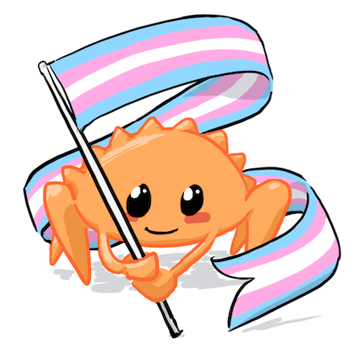

# rust

## WOAH A BLOG POST???

yes i have emerged from the depths of my bed to bring to the world another blog post. it's been... checks watch... 2 years since my last one... wow. i finally figured it's time to write something and completing this project has inspired me to actually write something.

the transformation of my site generator to rust is finally complete. it is written terribly and I will probably rewrite it all again very soon because the code is just terrible but i did it. welcome to my new and improved website but memory safe (yes because the backend is totally whats memory safe). anyways, you can check out the code at [github](https://github.com/ambrosiaforest/website). the old shell ssg is still there since i cant just kill my baby like that now that its vastly superior sibling exists.

theres a lot of reasons to write things in rust but honestly i just did this for the learning experience. rust is really taking off as a language and i think it's a very valuable language for me to learn. i've completed pretty much all of rustlings by now so i figured it try it out on a real life application.

stay tuned for future rust projects!
